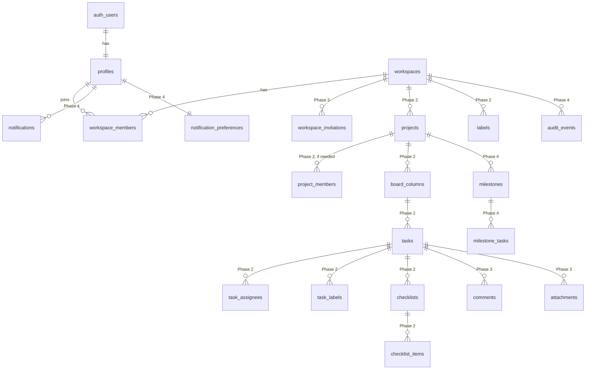

# Taskforge architecture

Taskforge is a multi-tenant project management app: people belong to one or
more **workspaces**, and everything else (projects, boards, tasks, comments,
files) belongs to exactly one workspace. Keeping workspaces sealed off from
each other is the single most important property of the system.

## Product idea

Taskforge is built for people who've never "managed a project". Instead of
an empty board, a project starts from a template and a finish date, and is
shown as a **journey**: phases drawn as stops on a line, with the current
phase highlighted ("you are here"). Three ideas run through the UI:

- **Start from a plan, not a blank page.** 30 built-in templates across 8
  categories (`src/lib/templates/library.ts`), plus templates a team saves
  from its own projects. Dates are counted back from the finish date.
- **Always show what to do next.** The workspace home lists the person's
  open tasks grouped as Overdue, Today, Next few days, Later.
- **Hide the machinery.** The Plan view is a checklist per phase; ticking a
  task moves it to the board's done column behind the scenes. The board and
  list are still one tab away for people who want them.

Visual language ("warm studio"): a soft off-white page and light warm
sidebar, white cards, coral as the single action colour, amber for
"now/today", green for done, a deeper red kept for overdue and destructive
actions, rounded corners, and one typeface (Plus Jakarta Sans) throughout.
Light is the default; people can choose Dark or "Match my computer" from
the user menu (next-themes, saved in the browser). Each template category
has its own icon and soft tint so the template library can be scanned by
topic. Tokens live in `src/app/globals.css`.

## Stack and why

| Layer | Choice | Why |
| --- | --- | --- |
| Web app | Next.js 16 (App Router), React 19, TypeScript (strict) | Server Components keep data access on the server; Server Actions give type-safe mutations without a separate API. |
| UI | Tailwind CSS v4, shadcn/ui (Base UI primitives), lucide icons | Accessible primitives (focus, keyboard, ARIA) we own and can edit. |
| Database and auth | Supabase: Postgres, Auth, Storage, Row Level Security | One free-tier service covers database, email/password auth and files, and RLS enforces tenancy inside the database itself. |
| Validation | Zod | One schema validates form input on the server and documents the rules. |
| Tests | Vitest + Testing Library, pgTAP (`supabase test db`), Playwright | Unit, database-policy and real-browser coverage. |
| Hosting | Vercel (app) + Supabase (data), both free tiers to start | No servers to run. |

Drag and drop uses `@dnd-kit/core` and `@dnd-kit/sortable` for mouse and
touch. Keyboard moving is our own small handler (Space, arrow keys, Space),
because dnd-kit's keyboard sensor scrolls a sideways-scrolling board instead
of moving the card. Every card also has a "Move" menu.

### Decisions worth knowing

- **Authorization lives in the database.** RLS policies decide what every
  query can see or change. Server Actions also check roles first, but only to
  give clear error messages; they are not what keeps data safe.
- **No service-role key at all.** Every query runs as the signed-in user.
  Jobs that need more rights (the daily retention purge) run inside the
  database via pg_cron. If a later feature needs elevated access from the
  app, it must be isolated in a server-only module.
- **Writes that must happen together go through a Postgres function.**
  `create_workspace()` creates the workspace and its owner membership in one
  transaction. There is deliberately no INSERT policy on those tables.
- **Workspaces are addressed by slug in the URL** (`/w/acme-studio-k3x9qa`).
  The random suffix avoids name clashes and doesn't reveal which names exist.
  Non-members get a 404, not a 403, so slugs can't be probed.
- **Cache Components is off, and every page renders per request** (see
  `next.config.ts` and the root layout). Nearly every page depends on the
  signed-in user, and the Content Security Policy needs a fresh nonce on
  each page's scripts, which a page built ahead of time can't have.
- **Permission checks run once per query, not once per row.** Read
  policies check `project_id in (select visible_project_ids())`. Postgres
  works out the list of visible projects once and compares each row with
  it. The earlier per-row function call made workspace-wide queries
  30 to 70 times slower. A pgTAP test keeps this rule identical to
  `project_access_for()`, which write checks use.
- **Proxy (formerly "middleware") only refreshes the session** and does
  optimistic redirects. It is not a security boundary.

## Folder structure

```
src/
  app/
    (auth)/            sign-in, sign-up, password reset; actions.ts
    (app)/             signed-in area
      w/[slug]/        workspace shell (sidebar), overview, settings
      account/         profile, photo, password
      onboarding/      first workspace
      workspaces/new/  additional workspaces
      workspace-actions.ts
    auth/confirm/      route handler for links in auth emails
  components/          shared UI (ui/ holds shadcn primitives)
  lib/                 server data access (auth.ts, workspaces.ts, profiles.ts),
                       validation, permissions, helpers
    supabase/          Supabase clients and generated database types
  app/api/health/      uptime check (app + database)
  instrumentation.ts   one JSON log line per server error
  proxy.ts             session refresh and Content Security Policy on every request
supabase/
  migrations/          SQL migrations (schema, RLS, storage policies)
  tests/database/      pgTAP tests for RLS and role rules
  templates/           auth email templates
  seed.sql             local demo data
tests/
  unit/                Vitest
  e2e/                 Playwright
```

## Data model

Built so far: `profiles`, `workspaces`, `workspace_members`, the `avatars`
bucket (Phase 1); `projects`, `project_members`, `board_columns`, `tasks`
(including subtasks), `task_assignees`, `labels`, `task_labels`,
`checklists`, `checklist_items` (Phase 2); `workspace_invitations`,
`comments`, `comment_mentions`, `attachments` and the `attachments` bucket
(Phase 3); `milestones` (shown as "phases"), `milestone_tasks` and
`project_templates` (Phase 4a); `audit_events`, `notifications` and
`notification_preferences` (Phase 4b). The rest is the plan for later
phases and may change as each phase is designed in detail.



Conventions for every table:

- `id uuid` primary key (except pure join tables, which use a composite key).
- `workspace_id` on every tenant-owned table, even when it could be derived
  through a parent, so each RLS policy is one cheap membership check.
- `created_at` / `updated_at` maintained by triggers.
- Ordered lists (columns, tasks) use a numeric `position` with gaps, so a
  drag-and-drop move updates one row instead of renumbering everything.
- Child rows repeat `workspace_id`/`project_id`, and their foreign keys
  include those columns. That makes cross-tenant links impossible at the
  database level: a label from workspace B can't be attached to a task in
  workspace A, and only workspace members can be assigned.
- Task edits carry a `version` number. A save made from a stale copy is
  rejected with a clear message instead of overwriting someone else's edit.

### Project access

| | Workspace owner/admin | Project owner | Other member | Viewer |
| --- | :-: | :-: | :-: | :-: |
| See a workspace-visible project | ✓ | ✓ | ✓ | ✓ |
| See a private project | ✓ | ✓ | if added | if added |
| Edit tasks and columns | ✓ | ✓ | ✓ | |
| Project settings, archive, delete | ✓ | ✓ | | |
| Edit an archived project | ✓ | ✓ | | |
- Indexes on every foreign key used for filtering.

### Roles

| Capability | Owner | Admin | Member | Viewer |
| --- | :-: | :-: | :-: | :-: |
| See the workspace and its members | ✓ | ✓ | ✓ | ✓ |
| Rename the workspace | ✓ | ✓ | | |
| Change roles / remove non-owners | ✓ | ✓ | | |
| Grant, change or remove the owner role | ✓ | | | |
| Delete the workspace | ✓ | | | |
| Create and edit projects and tasks (Phase 2) | ✓ | ✓ | ✓ | |
| Leave the workspace | ✓* | ✓ | ✓ | ✓ |

\* A workspace always keeps at least one owner. The last owner can't leave or
demote themselves until they make someone else an owner; this is enforced by
a database trigger that also locks the workspace row to prevent two owners
demoting each other at the same moment. Ownership transfer (Phase 3) will
promote the new owner first, then demote the old one, in one transaction.

## Feature matrix

| Area | Phase | Status |
| --- | --- | --- |
| Email/password sign-up with verification, sign-in, sign-out | 1 | Built |
| Password reset by email, password change | 1 | Built |
| Onboarding, create/switch/rename/delete workspaces | 1 | Built |
| Profile name and avatar (private bucket, signed URLs) | 1 | Built |
| RLS for profiles, workspaces, memberships, avatars | 1 | Built |
| Projects (create, edit, archive, delete, private projects) | 2 | Built |
| Kanban board: custom columns, drag and drop, keyboard moving, quick add | 2 | Built |
| Tasks: drawer, priority, dates, assignees, labels, subtasks, checklists, duplicate, archive, soft delete and restore | 2 | Built |
| Filters, search, list view with sorting, project overview | 2 | Built |
| Invitations (copy-link and in-app), role changes, member removal, leaving, ownership transfer | 3 | Built |
| Comments with @mentions, editing and deleting | 3 | Built |
| Attachments: private bucket, type and size checks, 100 MB per workspace, signed downloads | 3 | Built |
| Invitation emails | Later | Needs an email provider |
| Template library (30), new project wizard, save project as template | 4a | Built |
| Phases with progress from real tasks, journey strip, Plan view | 4a | Built |
| Home page with "Do next" | 4a | Built |
| In-app notifications (assigned, mentioned, commented) with inbox, unread badge and preferences | 4b | Built |
| Activity history per project and per workspace, CSV export for admins | 4b | Built |
| Timeline view; overview widgets for phases, workload and recent activity | 4b | Built |
| Email notifications and due-date reminders | Later | Need an email provider and a scheduled job |
| Security headers and CSP, database-wide security tests, dependency audit | 5 | Built |
| Foreign key indexes, once-per-query permission checks | 5 | Built |
| Automated WCAG 2.2 AA checks (light and dark), skip link, reduced motion | 5 | Built |
| Health check, error logging, daily retention job, file clean-up on delete | 5 | Built |
| Deployment, monitoring and backup guide ([deployment.md](deployment.md)) | 5 | Written; deploying needs your Supabase and Vercel accounts |

## Threat model (summary)

| Threat | Mitigation |
| --- | --- |
| Reading or changing another workspace's data | RLS on every tenant table; pgTAP tests attempt cross-tenant reads and writes. |
| Privilege escalation (viewer edits, admin grants owner) | Role-based RLS policies plus the `enforce_membership_rules` trigger; column-level grants limit which fields can be updated. |
| Spoofing identity fields (e.g. editing your profile email) | Email is synced from Auth by trigger; users have no UPDATE grant on it. |
| Account enumeration | Sign-up and password-reset responses are the same whether or not the email exists. |
| Open redirect via `?next=` | `safeRedirectPath` only allows same-site paths. |
| Malicious uploads | Private bucket, 2 MB limit, PNG/JPEG/WebP only (checked by file content, not name), uploads confined to the user's own folder; SVG rejected. |
| XSS | React escapes output and nothing renders raw HTML. As a second layer, a Content Security Policy only lets scripts carrying the page's per-request nonce run, so an injected `<script>` is refused by the browser. |
| Clickjacking, MIME sniffing | `frame-ancestors 'none'` and `X-Frame-Options: DENY`; `X-Content-Type-Options: nosniff`; HSTS; a strict Referrer-Policy so invite tokens in URLs never leak to other sites. |
| A future table or function skipping the rules | `hardening.test.sql` fails if any table lacks RLS, signed-out visitors get any table or privileged function, a SECURITY DEFINER function lacks a fixed search_path, a bucket is public or unlimited, or a foreign key lacks an index. |
| CSRF | Server Actions only accept POST from the same origin (Next.js checks the Origin header); auth cookies are SameSite=Lax. |
| Leaked secrets | The app uses no secret or service-role key at all; `.env*` and database backups are git-ignored; only `NEXT_PUBLIC_` values reach the browser and they are safe by design. |
| Abuse / cost | Supabase Auth's built-in rate limits on sign-in and emails; a 10-owned-workspace cap per user; 200 projects per workspace. Invitation rate limits come with invitations in Phase 3. |
| Invite links leaked or forwarded | Only a SHA-256 hash of the token is stored; accepting requires being signed in with the invited, verified email; links expire after 7 days and are single use. |
| Invitation spam | 20 invitations per workspace per hour, 100 open at once. |
| Mention spoofing or pinging outsiders | Mentions are stored as user ids; the server drops mentions of anyone who can't see the project; names are shown from the live member list. |
| Malicious file uploads | 5 MB limit; type checked from file content against an allow-list (no HTML, SVG or executables); safe file names; private bucket; storage policies check the workspace and project in the path; downloads use 60-second signed URLs that force a download. |
| Tampering with history | `audit_events` is written only by triggers inside the same transaction as the change; the API has read access only, no insert, update or delete. |
| Leaking private work through notifications | A notification is only created if the recipient can see the project, and is hidden again if they later lose access. |
| CSV formula injection in exports | Exported cells that start with `=`, `+`, `-` or `@` are prefixed so spreadsheets treat them as text. |
| Lost edits from concurrent changes | Version check on task saves; board moves are recomputed on the server from current positions. |
| Sensitive data in logs | Server logs record error codes and messages only, never form input. |

## Audit history: what's kept and for how long

Recorded: task created, moved, renamed, re-dated, re-prioritised, archived,
deleted or restored; assignments; comments added (not their text); files
added or removed (name only); phase and project changes; members joining,
leaving or changing role; invitations sent, revoked or declined. Each event
stores who, when, the workspace/project/task ids and a small summary.

Never recorded: passwords, tokens, task descriptions, comment text or file
contents.

Who can read it: owners and admins see everything in their workspace;
other members see the history of projects they can currently see.

Retention: a daily job (pg_cron, 03:17 UTC) deletes events older than 12
months, notifications read more than 90 days ago (and any older than 12
months), and invitations that stopped working more than 90 days ago.
Everything is also deleted with its workspace. Admins can export the
latest 5,000 events as CSV at any time.

## Free-tier constraints

Limits change; check the current Supabase and Vercel pricing pages before
launch. At the time of writing, the free tiers roughly allow:

- **Supabase:** 500 MB database, 1 GB file storage, 50,000 monthly active
  users, a few emails per hour from the built-in mailer (fine for testing,
  not for real users; production needs a custom SMTP provider), and projects
  pause after a week of inactivity.
- **Vercel Hobby:** for personal, non-commercial projects. A commercial
  launch needs the Pro plan.

Guardrails already in place: 2 MB avatar limit, old avatars deleted on
replace, workspace cap per user, 5 MB per attachment and 100 MB of
attachments per workspace.

Deleting a project or workspace removes its attachment files from storage
first, then the records, so no orphaned files use up the quota.

## Likely paid needs later

Custom SMTP for reliable auth and notification email, Vercel Pro for
commercial use, Supabase Pro for daily backups with point-in-time recovery
and no project pausing, and an error-reporting service beyond the free tier.
